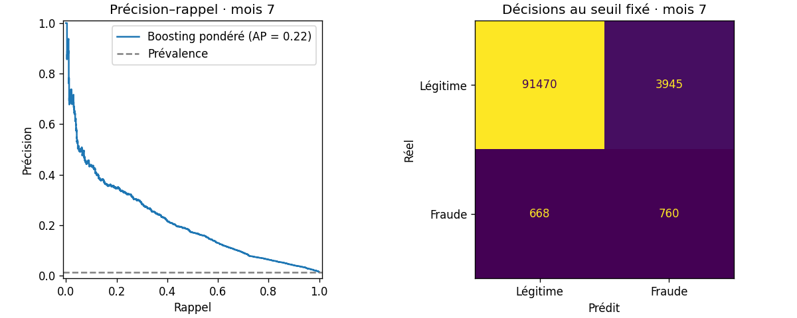
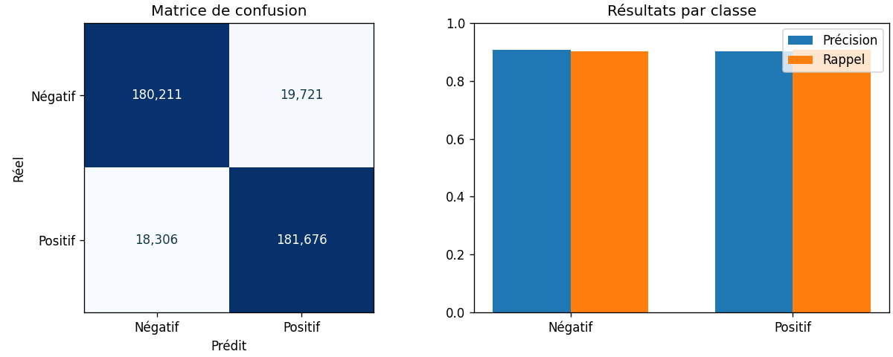

# TP3 — Le cycle complet d’un projet data

## Objectif

Suivre les sept étapes d’un projet data, du CSV brut à la prédiction avec un modèle sauvegardé. Les deux études permettent de comparer une démarche classique sur données tabulaires et une démarche Big Data sur des textes.

| | `small/` — Data classique | `big/` — Big Data |
|---|---|---|
| **Sujet** | Détection de fraude à l’ouverture d’un compte | Classification du sentiment des avis Amazon |
| **Notebook du TP** | [Fraude bancaire](small/TP3_small_fraude_bancaire.ipynb) | [Sentiment Amazon avec Spark](big/TP3_big_sentiment_amazon_spark.ipynb) |
| **Notebook de départ** | [Bank Account Fraud — Matthew McNulty](https://www.kaggle.com/code/matthewmcnulty/bank-account-fraud) | [Sentiment Analysis with Amazon Reviews — MuonNeutrino](https://www.kaggle.com/code/muonneutrino/sentiment-analysis-with-amazon-reviews) |
| **Volume brut** | 1 million de demandes synthétiques, 213 Mo | 4 millions d’avis, 1,74 Go |
| **Outils** | pandas et scikit-learn | Spark DataFrames, Spark SQL et Spark ML |
| **Cycle** | Data → EDA → Prétraitement → Transformation → ML → Évaluation → Déploiement | Spark (Data → EDA → Prétraitement) → Transformation → ML → Évaluation → Déploiement |

## Organisation

```text
TP3/
├── README.md
├── small/
│   ├── TP3_small_fraude_bancaire.ipynb
│   ├── bank_fraud_dataset/
│   │   └── Base.csv.gz
│   ├── artefacts/
│   │   ├── modele_fraude.joblib
│   │   ├── config.json
│   │   ├── metriques_test.json
│   │   ├── eda.png et evaluation.png
│   │   └── exemple_entree.csv et predictions.csv
│   └── requirements.txt
└── big/
    ├── TP3_big_sentiment_amazon_spark.ipynb
    ├── amazon_reviews_dataset/
    │   ├── train-*.csv.gz
    │   └── test.csv.gz
    ├── artefacts/
    │   ├── modele_sentiment_spark/
    │   ├── config.json
    │   ├── metriques_test.json
    │   ├── eda.png et evaluation.png
    │   └── exemple_entree.csv et predictions/
    └── requirements.txt
```

Chaque étude contient un notebook autonome, un dossier nommé d’après son jeu de données, les artefacts produits par le notebook et ses dépendances. Le `config.json` décrit le modèle et les colonnes à lui fournir. L’organisation reprend celle du [TP3 de Batigoal13](https://github.com/Batigoal13/BigData/tree/main/TP3).

## `small/` — Fraude bancaire (pandas et scikit-learn)

L’objectif est de repérer les demandes à examiner en priorité. Le dernier mois est réservé au test pour évaluer le modèle sur des demandes arrivées après l’apprentissage. La cible `fraud_bool` vaut 1 pour les demandes frauduleuses. [Jeu BAF de Feedzai](https://github.com/feedzai/bank-account-fraud) · [Publication NeurIPS 2022](https://arxiv.org/abs/2211.13358)

| Étape | Ce que fait le notebook |
|---|---|
| **Data** | Charge `Base.csv`, la variante de référence de Bank Account Fraud. |
| **EDA** | Compare le taux de fraude par mois et visualise les valeurs manquantes. |
| **Prétraitement** | Traite les valeurs sentinelles et sépare les mois 0 à 5 pour l’apprentissage, 6 pour la validation et 7 pour le test. |
| **Transformation** | Encode les variables catégorielles dans un pipeline scikit-learn. |
| **ML** | Compare deux modèles de gradient boosting, avec et sans pondération des classes. |
| **Évaluation** | Mesure l’AP et le rappel. Le seuil est choisi sur le mois 6 avec un plafond de 5 % de faux positifs, puis appliqué au mois 7. |
| **Déploiement** | Sauvegarde le pipeline et le seuil. Recharge le modèle et applique les prédictions à un CSV. |

**Résultats sur 96 843 demandes du mois 7.** Le boosting pondéré obtient une **AP de 0,216**, contre **0,0147** pour la référence à score constant. Au seuil retenu, il repère **760 fraudes sur 1 428** (53,2 % de rappel). Il signale aussi **3 945 demandes légitimes** (4,13 % de faux positifs). [Métriques du test](small/artefacts/metriques_test.json) · [Graphique EDA](small/artefacts/eda.png)



## `big/` — Sentiment des avis Amazon (Spark)

Le corpus Amazon Polarity fournit **3,6 millions d’avis pour l’apprentissage** et **400 000 pour le test**. Chaque fichier est équilibré entre avis négatifs (1 ou 2 étoiles) et positifs (4 ou 5 étoiles). Les auteurs ont écarté les avis à 3 étoiles. [Publication CSV de Yassir Acharki](https://doi.org/10.34740/KAGGLE/DSV/5339021) · [Fiche du corpus](https://huggingface.co/datasets/yassiracharki/Amazon_Reviews_Binary_for_Sentiment_Analysis)

| Étape | Ce que fait le notebook |
|---|---|
| **Data** | Lit `train.csv` et `test.csv` avec Spark et un schéma explicite. |
| **EDA** | Agrège les classes, les champs vides et les longueurs des avis. Seuls les agrégats servent aux graphiques. |
| **Prétraitement** | Normalise les textes avec Spark SQL et enlève les doublons, y compris les avis du test déjà présents dans l’apprentissage. |
| **Transformation** | Tokenise les avis et construit des vecteurs TF-IDF avec `HashingTF` et `IDF`. |
| **ML** | Entraîne une régression logistique dans un pipeline Spark ML. |
| **Évaluation** | Compare le modèle à la classe majoritaire sur le test nettoyé et affiche la matrice de confusion et les scores par classe. |
| **Déploiement** | Exporte le `PipelineModel`, le recharge et écrit les prédictions d’un lot d’avis. |

**Résultats sur 399 914 avis de test après nettoyage.** La régression logistique classe correctement **90,49 %** des avis et atteint un **F1 macro de 0,9049**. La classe majoritaire obtient **50,01 %** de classifications correctes et un **F1 macro de 0,3334**. Le pipeline a été ajusté en **5 min 14 s** sous Ubuntu WSL avec Java 21, Spark 4.0.1, quatre threads et 6 Go pour le pilote. [Métriques du test](big/artefacts/metriques_test.json) · [Graphique EDA](big/artefacts/eda.png)



## Installation et exécution

Les jeux complets sont inclus dans le dépôt GitHub sous forme de CSV compressés. pandas lit `small/bank_fraud_dataset/Base.csv.gz` et Spark lit `big/amazon_reviews_dataset/train-*.csv.gz` et `test.csv.gz` directement après le clonage. Les notebooks lisent aussi les CSV non compressés s’ils sont présents.

Pour récupérer les CSV directement depuis Kaggle, extraire `Base.csv` dans `small/bank_fraud_dataset/`, puis `train.csv` et `test.csv` dans `big/amazon_reviews_dataset/`. [Archive BAF](https://www.kaggle.com/datasets/sgpjesus/bank-account-fraud-dataset-neurips-2022/data) · [Archive Amazon](https://www.kaggle.com/datasets/yacharki/amazon-reviews-for-sa-binary-negative-positive-csv/data)

L’installation commune figure dans le [README principal](../README.md). Les deux études peuvent aussi être installées séparément avec les commandes ci-dessous. Pour Spark sous Windows, l’exécution a été validée sous Ubuntu WSL avec Java 21. Spark 4.0.1 prend en charge Java 17 et 21. [Documentation Spark 4.0.1](https://spark.apache.org/docs/4.0.1/)

<details>
<summary>Commandes d’installation depuis TP3</summary>

**Étude classique sous Windows (PowerShell)**

```powershell
python -m venv .venv
.\.venv\Scripts\python.exe -m pip install -r small\requirements.txt
.\.venv\Scripts\python.exe -m ipykernel install --sys-prefix --name python3
cd small
..\.venv\Scripts\python.exe -m nbconvert --to notebook --execute --inplace --ExecutePreprocessor.timeout=1800 TP3_small_fraude_bancaire.ipynb
```

**Étude Big Data sous Linux ou WSL**

```bash
python3 -m venv .venv-linux
.venv-linux/bin/python -m pip install -r big/requirements.txt
.venv-linux/bin/python -m ipykernel install --sys-prefix --name python3
cd big
../.venv-linux/bin/python -m nbconvert --to notebook --execute --inplace --ExecutePreprocessor.timeout=3600 TP3_big_sentiment_amazon_spark.ipynb
```

</details>

- **Rejouer l’étude.** Dans Jupyter ou VS Code, sélectionner l’environnement installé et exécuter les cellules depuis le dossier du notebook.
- **Tester le modèle fourni.** Lancer **Configuration**, puis **Prédire avec le modèle sauvegardé**. La cellule prend le CSV d’exemple par défaut et écrit le résultat dans `artefacts/`. Pour les avis Amazon, le CSV d’entrée contient `title` et `body`.
- **Faire un essai rapide avec Spark.** Définir `TP3_BIG_FRACTION=0.02` avant le lancement. Spark lit les CSV et entraîne le modèle sur environ 2 % des avis. Les résultats de cet essai sont écrits dans `big/artefacts/rapide/`.
- **Ajuster les ressources Spark.** Le mode complet utilise tous les avis. Les paramètres `TP3_SPARK_MASTER`, `TP3_SPARK_MEMORY` et `TP3_SPARK_SHUFFLE` permettent de modifier les valeurs locales par défaut (`local[4]`, `6g` et 32 partitions de redistribution).
